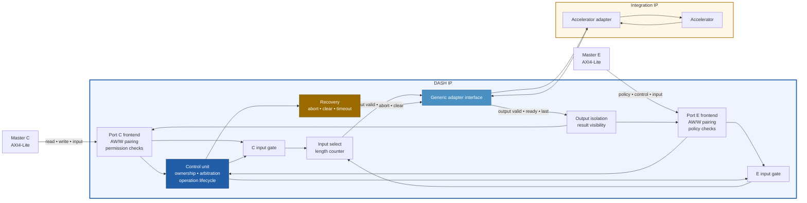
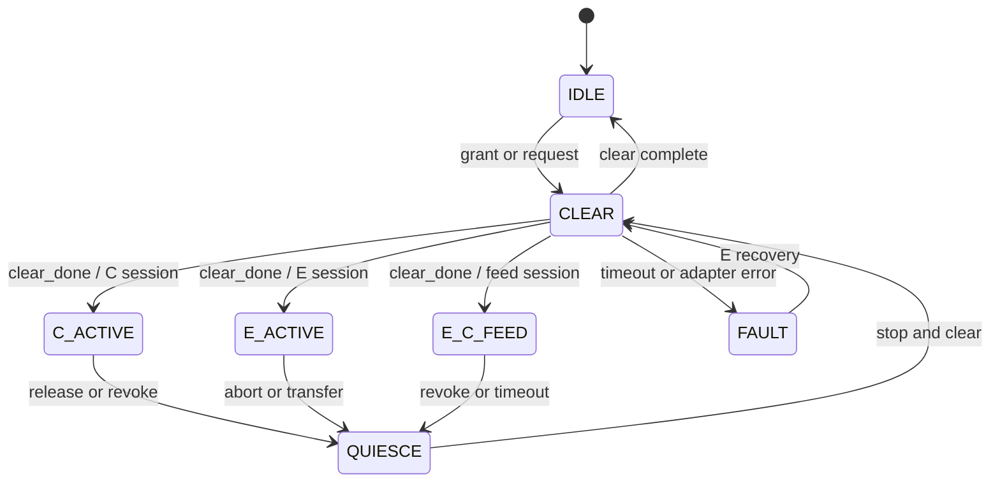

# DASH — Dual-domain Accelerator Sharing Hub

DASH is a standalone, reusable hardware IP block for securely sharing one
accelerator between two physically separate AXI4-Lite slave ports:

- **E** — the trusted master that owns security policy and can revoke access.
- **C** — the untrusted master whose access is limited by E’s policy.

Master identity comes from the physical port. There is no software-programmable
master ID and DASH never exposes a bridge between the two buses. The controller
is independent of the accelerator algorithm: a compatible adapter is the only
accelerator-specific logic required at the DASH boundary.

This repository contains the native SystemVerilog and Bluespec SystemVerilog
implementations, the dummy adapter used for verification, self-checking
testbenches, formal harnesses, and the common architecture specification.

## Architecture at a glance



The blue box is DASH.

The yellow box is supplied by the integrator.

C input enters through Port C.

E input enters through Port E.

The control unit selects the allowed source for the active session.

### Ownership and recovery



## Architecture

Both implementations use one common clock for the two AXI ports and the
accelerator adapter. A separate clock domain requires a CDC bridge outside the
common controller. Trusted reset is fail-closed: C access is disabled, policy
and ownership return to a safe state, results are invalidated, and the adapter
must be cleared before a new grant.

The controller supports:

1. **Trusted-owned operation** — E has exclusive control.
2. **Untrusted-owned operation** — C operates under E-configured permissions.
3. **Trusted-controlled C-feed** — E configures and authorizes the operation;
   C supplies only bounded input.

Ownership transitions use quiesce, abort/finish, result invalidation, buffer
flush, adapter clear, and clear acknowledgment before granting a new owner.
Clear timeout, adapter error, input-length violations, and illegal protected
commands fail closed and are reported to E.

The generic adapter contract is deliberately narrower than an accelerator’s
native bus. DASH uses configuration valid/ready, input valid/ready with byte
strobes and `last`, output valid/ready with `last`, start, abort, clear,
`clear_done`, busy, done, and error. See
[`spec/adapter_contract.md`](spec/adapter_contract.md) for the required
security guarantees.

## Layout

```text
rtl/sv/              Native synthesizable SystemVerilog DASH and dummy adapter
rtl/bsv/             Native Bluespec DASH, adapter, and Verilog top
tb/sv/               SV self-checking simulations
tb/bsv/              BSV self-checking simulations
formal/              Yosys/SVA/formal harnesses
spec/                Common architecture, register map, contract, and evidence
scripts/             Common regression and repository checks
build/               Ignored generated logs and simulator output
```

## Register map and contract

The authoritative register map is [`spec/register_map.md`](spec/register_map.md).
The common behavioral specification is [`spec/architecture.md`](spec/architecture.md),
and the adapter obligations are in [`spec/adapter_contract.md`](spec/adapter_contract.md).
Security-sensitive partial writes are rejected rather than applied partially.
Unauthorized transactions return a defined AXI error and have no protected
side effect.

## Prerequisites

The local verification flow expects:

- Icarus Verilog with SystemVerilog support (`iverilog`, `vvp`)
- Verilator (lint)
- Bluespec Compiler (`bsc`) and its libraries
- Yosys, `yosys-smtbmc`, and Z3 for the formal targets
- Python 3 for the common transaction-level scoreboard

`BLUESPECDIR` may be set when the compiler is installed outside the default
location. The Makefile defaults to `/home/joel/tools/bsc/lib` for this
workspace.

## Build and verification

Run the focused simulations:

```sh
make sv-test          # SV revocation/ownership regression
make sv-feed          # controlled-feed behavior
make sv-axi-random    # randomized AXI traffic
make sv-reset         # reset behavior
make sv-fault         # adapter fault behavior

make bsv-test         # native BSV regression
make bsv-feed         # BSV controlled-feed behavior
make bsv-axi-random   # randomized BSV traffic
make bsv-reset        # generated BSV RTL reset check
make bsv-fault        # BSV adapter fault behavior
make bsv-timeout      # clear-timeout/fail-closed behavior

make common-test      # normalized SV/BSV transaction-level comparison
make sv-lint          # Verilator lint
make formal           # SV bounded formal check
make bsv-formal       # BSV-generated RTL bounded formal check
```

Generated files and logs are placed under `build/` or ignored simulator output
paths. `make clean` removes DASH build products.

The executed verification evidence and current limitations are maintained in
[`spec/verification_matrix.md`](spec/verification_matrix.md). A passing
simulation is not a claim that every possible accelerator adapter is safe: the
adapter contract must be met and separately reviewed for each integration.
